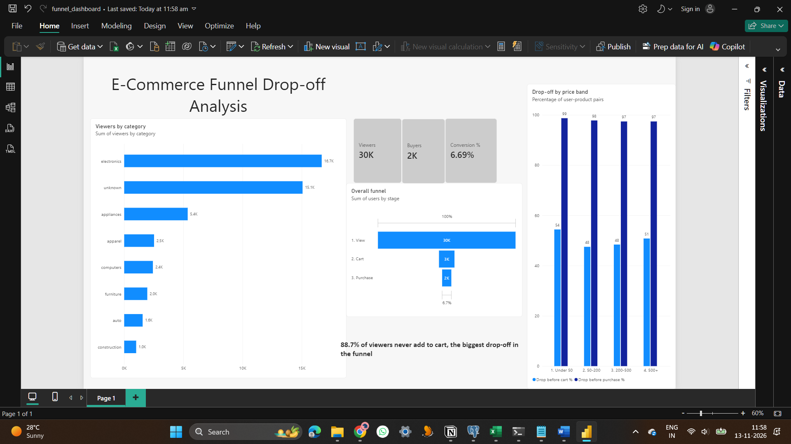

# E-Commerce Funnel Drop-off Analysis

Where do shoppers leave an online store, and which products lose the most of them? This project follows users through **view → add to cart → purchase** using SQL (PostgreSQL) and a Power BI dashboard.

## Problem
Only a small share of visitors end up buying. The goal is to find the steps and product segments where the biggest drop-offs happen, and suggest what to test.

## Data
- Source: [eCommerce behavior data from multi category store](https://www.kaggle.com/datasets/mkechinov/ecommerce-behavior-data-from-multi-category-store) (Kaggle, October 2019).
- The full file is several GB, so I took a **1% sample of users** (`user_id % 100 = 0`) with `sample.py`. All events of each sampled user are kept, so their full journey is intact.
- Result: **419,989 events from 30,066 users**.

## Approach
1. Sampled the raw file with Python (pandas, read in chunks).
2. Loaded the sample into PostgreSQL and converted `event_time` to a timestamp.
3. Built a strict funnel in SQL: a user counts as a cart user only if they also viewed, and as a buyer only if they viewed and carted. Used CTEs, `bool_or` and `FILTER`.
4. Broke the funnel down by product category and by price band.
5. Exported the results as CSVs and built the dashboard in Power BI.

## Key findings
- **Only 6.7% of users buy** (30,066 viewers → 3,388 cart users → 2,011 buyers).
- **The biggest drop-off is view → cart: 88.7%.** A further 40.6% of cart users do not buy.
- **Electronics converts best:** about 8.8% of its viewers buy, and its view → cart drop is the lowest of the large categories (85.4%). Appliances (92.0%) and computers (95.6%) lose more shoppers before the cart.
- **Price has little effect on view → cart drop-off** (97–99% in every band). The cheapest items (under 50) convert worst, about 0.6% versus roughly 1.2–1.3% in the other bands, and have the highest cart abandonment (54.4%).
- **About 41% of buyers have no cart event** (1,427 of 3,438), which suggests direct "buy now" behavior or a cart created before the period covered.

## Recommendations (hypotheses to test)
- Improve product pages (comparison, reviews, offers) to lift view → cart.
- Use cart reminders, free delivery thresholds or EMI offers to reduce cart abandonment.
- For low-priced items, check whether delivery fees or minimum-order rules push shoppers away.
- Fix missing category data so the "unknown" traffic can be analyzed.

## Limitations
- 1% user sample from one month, so results are indicative, not exact.
- About a third of events have no category, and almost half of viewers fall into "unknown".
- Price band counts are user-product pairs, not users, so they are not directly comparable with the user-level funnel. Prices are in the dataset's currency units.
- The category breakdown counts a user in every category they browsed, so category viewers add up to more than the total users.
- Tiny categories (fewer than 10 cart users) are left out of the dashboard because their percentages are noise.

## Files
- `sample.py`: creates the 1% user sample
- `queries.sql`: all SQL used
- `funnel.csv`, `category.csv`, `price_band.csv`: query results used in Power BI
- `funnel_dashboard.pbix`: Power BI dashboard
- `dashboard.png`: screenshot

## Tools
Python (pandas), PostgreSQL, SQL, Power BI
